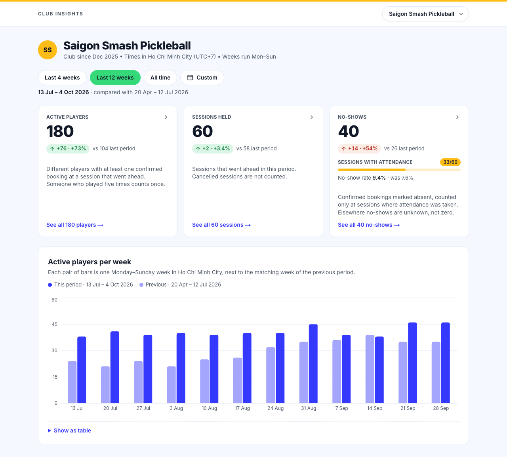
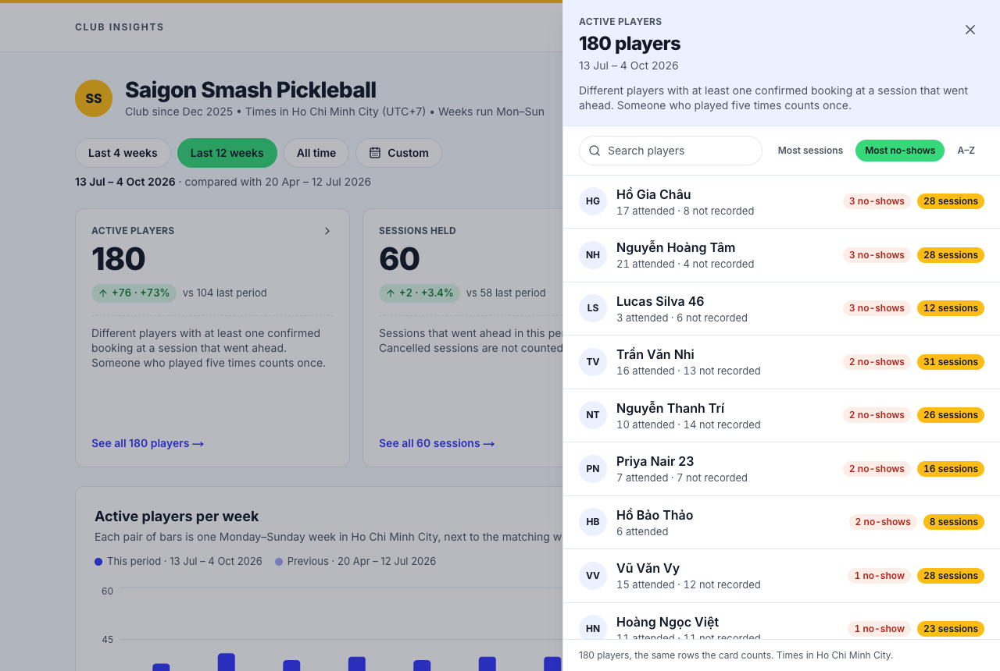
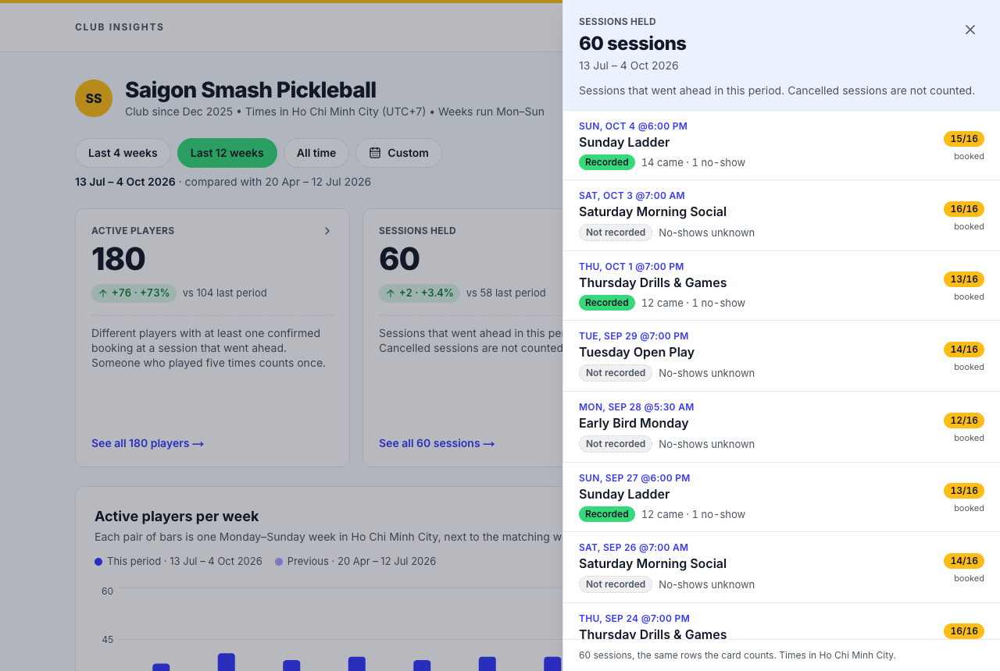
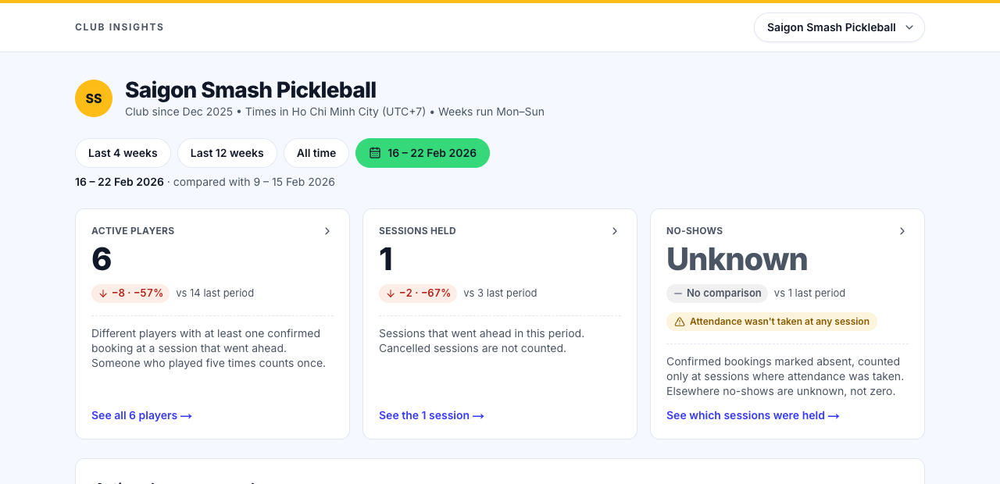
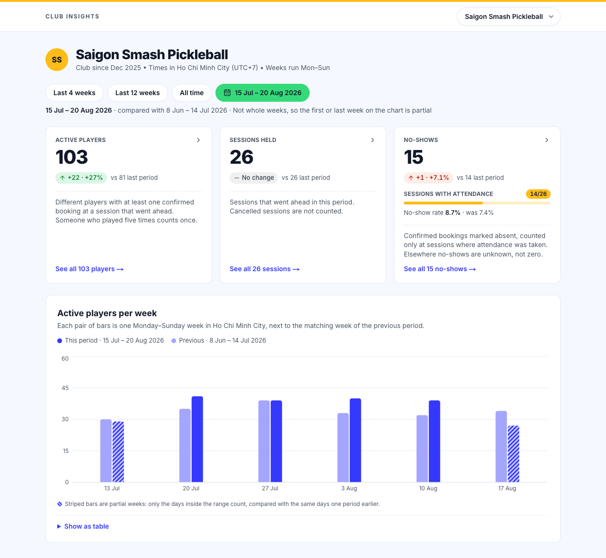
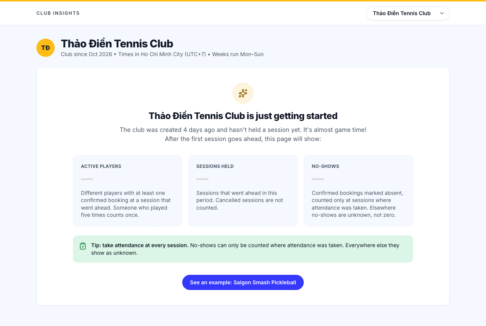
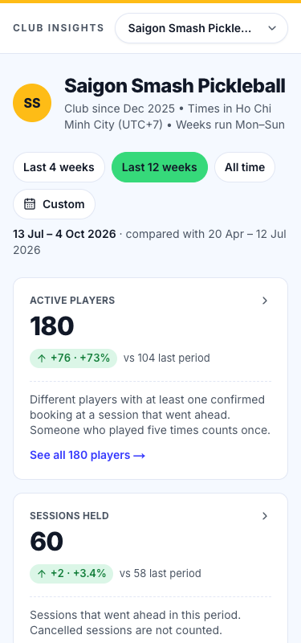

# Club Insights

A dashboard that shows a sports club host how their club is doing: **are more people playing, and who doesn't show up?**

### ▶ Live demo: **[club-insights-orcin.vercel.app](https://club-insights-orcin.vercel.app)**

No login needed. "Now" is fixed at **Monday 5 October 2026, 09:00 (Ho Chi Minh City)**, as the brief requires.



---

## 1. Overview

**For reviewers in a hurry: a 60-second tour of the live demo**

1. **Read the three cards.** Active players, sessions held and no-shows for the last 12 weeks, each compared with the 12 weeks before. The definition of each number sits right under it.
2. **Click any card.** A side panel lists the exact players or sessions behind that number, and the count always matches the card. In *Active players*, sort by **Most no-shows** to see who doesn't turn up.
3. **Change the range.** Try *Last 4 weeks*, *All time* or a custom range. The comparison period updates and is always written out in dates.
4. **Look at a week with no attendance data.** Pick the custom range 16–22 Feb 2026. No-shows show **Unknown**, not 0, because attendance wasn't taken that week.
5. **Switch club** (top right) to *Thảo Điền Tennis Club*. It was created four days ago and has no data, so it gets a guide page instead of a row of zeros.

| What the brief asked for | Where it is |
|---|---|
| Three numbers for a chosen range, compared with the period before | Metric cards + range picker |
| One number week by week as a chart | *Active players per week* |
| Open a number to see what's behind it | Click any card |
| Definition shown next to each number | Under every number, always visible |
| Weeks run Monday–Sunday in the club's time zone | Computed in `Asia/Ho_Chi_Minh` (tested) |
| Missing attendance means unknown, not zero | Unknown state, coverage badge, no-show rate |
| A useful page for the club with no data | Guide page for the new club |
| JSON API (shared with a future mobile app), SQLite seeded from CSV | `app/api/**`, `lib/seed.ts` |
| Runs with one command, README, a test for the riskiest number | `npm run dev`, this file, 54 tests |

---

## 2. Engineering & Product Process

I treated this as a small product rather than a coding exercise. The brief says the screens are what's judged hardest, and in particular whether a host **understands and trusts** the numbers. So the work went in this order: understand the problem, then the data, then the design language, then build in phases with a definition of done for each.

### 2.1 Problem analysis

I broke the brief into a checklist (the table above) and listed the places where a dashboard like this usually goes wrong:

- **Unknown vs zero.** Attendance was taken at only some sessions. Treating a missing mark as "showed up" would make no-shows look better than they are.
- **Time zones.** Data is stored in UTC, but weeks must run Monday–Sunday in Ho Chi Minh City (UTC+7).
- **The period before.** It needs to be the same length and sit immediately before the selected range.
- **Trust.** If a card says 180 and the list behind it has 176 rows, the host stops believing the dashboard.
- **The empty club.** It must not render "0 0 0".

Then I **audited the real CSVs** before writing any code. My early notes had been written from a partial file and were wrong in several places. The audit corrected them:

| Early assumption | What the data actually showed |
|---|---|
| Data ends in July, so a "last 12 weeks" default would be empty | Data runs to **4 Oct 2026**, the day before "now", so the default range has data |
| Must infer which sessions took attendance | `sessions.attendance_recorded` flags it explicitly (104 of 195) |
| Some sessions have partial attendance | None do, but the code still treats a missing mark as unknown |
| About 1,080 bookings | **1,893** bookings, with 9 cancelled sessions and no bookings on them |
| The time-zone trap is theoretical | **39 real sessions** start Sunday 22:30 UTC, which is **Monday 05:30** local time |

Those facts became fixed test values. Every expected number in the integration tests was computed **independently in Python** from the raw CSVs, not by the code under test.

### 2.2 UI/UX research

Since there was no mockup, I based the design on the product family the dashboard would belong to:

- I studied the hiring company's **public website**: typography, colour classes, button and card shapes, and tone of voice.
- I studied **11 screenshots of its mobile app from the app store**. This mattered more, because the brief says the mobile app will reuse this API, so the dashboard should feel like part of the same product.
- I **measured exact colours by sampling pixels** in those screenshots, rather than guessing.

What came out of it:

- **A colour grammar the app already uses consistently.** Blue means navigate or act. Green means selected or confirmed (always with dark text). Yellow means a count or capacity, shown as an `x/y` badge. Grey means neutral. The dashboard follows the same rules: the selected range preset is green, "Recorded" attendance is green, and coverage is a yellow `33/60` badge.
- **The app's habits**: a light blue-tinted page background, white rounded cards, pill buttons and tags, small uppercase labels, counts written `x/y`, times written `Mon, Jul 13 @5:30 AM`.
- **Accessibility checks.** I checked every colour pair for contrast. Green and yellow fail with white text, so text on them is always dark. A charting-guideline validator showed my first "previous period" bar colour was too faint, so I replaced it with a darker step.
- **Only generic elements.** No logos, mascots or other brand assets are used.

The result is written down as a design system (`.memory/design-system.md`): tokens, typography, component patterns and a consistency checklist that every UI phase was reviewed against at 375, 768 and 1280 px.

### 2.3 Phased delivery

The work was split into 13 phases, one commit each. Every phase had a definition of done; the next phase didn't start until it was met (type-check clean, tests green, and for UI phases, screenshots reviewed).

| # | Phase | Definition of done (abridged) |
|---|---|---|
| 1 | Scaffold | `npm install && npm run dev` serves a page; test runner and design tokens in place |
| 2 | Time utilities (test-first) | Monday–Sunday weeks in the club's zone; the real Sunday 22:30 UTC session lands in the Monday week |
| 3 | SQLite schema + seed | Row counts match; 894 unknown attendance marks kept as `NULL`; 39 weeks, all starting on Monday |
| 4 | Metric definitions as pure functions | The riskiest-number tests pass: unknown vs zero, cancellations, week edges |
| 5 | Shared SQL layer | SQL equals independently computed numbers and the reference functions on 80 ranges; card = drill-down rows |
| 6 | JSON API | Four endpoints; 400 with a clear message for bad input, 404 for an unknown club |
| 7 | App shell + club switcher | State in the URL; switching club keeps the range; no horizontal scroll at 375 px |
| 8 | Range presets + custom picker | Whole-week presets, Monday-first calendar, comparison period always shown |
| 9 | Metric cards | Definitions always visible, colour by meaning, coverage + rate, "Unknown" state |
| 10 | Weekly chart | Each week next to the same days one period earlier; partial weeks striped; table view |
| 11 | Drill-down panel | Row count equals the card; keyboard: Enter opens, Esc closes, focus returns |
| 12 | Empty states + polish | New-club guide, empty-range state, responsive fixes |
| 13 | README + clean-clone QA | Fresh clone: type-check, tests, production build, dev server seeding from an empty DB |

**Bugs found by this process and fixed before shipping:**
- Invalid dates returned a 500 instead of a 400.
- Partial weeks were compared with the wrong days.
- Faded partial-week bars looked like the previous period.
- Focus didn't return to the card after closing the panel.

### 2.4 Working with an AI assistant

The brief allows AI tools as long as every part can be explained. I used an AI coding assistant and kept it grounded with written project memory: the brief, rules, design system and progress log in [`.memory/`](.memory), and working instructions in [`.claude/`](.claude). Each phase was verified with real command output: tests, curl calls against the API, and screenshots at three widths. Those files are kept in the repo so the process can be reviewed.

---

## 3. Tech Stack & Key Architectural Decisions

### Stack

| Layer | Choice | Why |
|---|---|---|
| Framework | **Next.js 15** (App Router), **React 19**, **TypeScript** strict | One codebase for the UI and the JSON API (route handlers) |
| Database | **SQLite** via `better-sqlite3` | Required by the brief; synchronous, fast, a single file |
| Dates | **Luxon** | Time-zone-correct ISO weeks |
| Validation | **zod** | Every query parameter is validated at the API boundary |
| Data fetching | **SWR** | Caching keyed by URL; keeps the previous numbers visible while a new range loads |
| UI | **Tailwind CSS** + **Radix** primitives (dialog, popover), `react-day-picker`, `lucide-react` | Accessible building blocks styled with my own design tokens |
| Chart | **Recharts** | Grouped bars with custom tooltip and texture |
| Tests | **Vitest** | Unit + integration tests on an in-memory SQLite database |
| Hosting | **Vercel** | Read-only SQLite file bundled with the serverless functions |

### Architecture

```
data-csv/*.csv
   │  lib/seed.ts      parse, validate, keep NULL, compute local date + Monday week per club zone
   ▼
db/club-insights.db (SQLite, read-only at runtime)
   │  lib/queries.ts   SQL for cards, weekly series, drill-downs; one set of shared WHERE clauses
   ▼
app/api/**/route.ts    zod validation → query → JSON   (the only code that touches the DB)
   │  HTTP / JSON      same contract for the web and a future mobile app
   ▼
components/dashboard   client components, SWR, state in the URL (?club=&from=&to=)
```

### Key decisions

1. **Each metric is defined once, in two forms that are tested against each other.** `lib/metrics.ts` is a plain-function reference implementation. `lib/queries.ts` is the SQL the API runs. An integration test asserts they agree on 80 date ranges of real data, so changing one without the other fails CI. The on-screen wording lives in `lib/definitions.ts` and is returned by the API.

   | Metric | Definition |
   |---|---|
   | Active players | Distinct players with a confirmed booking at a session that went ahead. Based on bookings, not attendance, because attendance exists at only 104/195 sessions. |
   | Sessions held | Sessions not cancelled that have started by "now". |
   | No-shows | Confirmed bookings marked absent, counted only where attendance was taken. `null` (Unknown) if no session in the period took attendance. Always shown with coverage (`33/60` sessions) and the no-show rate. |

2. **Unknown is modelled as `null` end to end.** It is `NULL` in SQLite, `null` in JSON and "Unknown" or "Not recorded" in the UI, never coerced to 0. When attendance coverage differs by 15 points or more between the two periods, the card warns: *compare the rate, not the count*.

3. **Time zones are resolved once, at seed time.** Each session stores `date_local` and `week_start_local`, computed with Luxon from that club's `time_zone`. SQL never does time-zone maths, and timestamps use one canonical UTC format so string comparison equals time order.

4. **Cards and drill-downs share the same SQL filters** (`HELD`, `CONFIRMED`, `MARKED`, `NO_SHOW`), so a number and the rows behind it can't drift apart. This is tested.

5. **Like-for-like comparisons.** The previous period has the same number of days. In the weekly chart, each week is compared with the same days one period earlier, so edge weeks of a mid-week range stay fair and the weeks always add up to the card totals.

6. **The API is usable on its own.** `from`/`to` are optional (default: last 12 full weeks), ranges are capped at 731 days, errors come back as `{ error: { code, message } }`, and every metric carries its definition. A mobile client needs no date or metric logic.

7. **State lives in the URL**, so any view can be shared or bookmarked. Switching club keeps the range.

8. **The deployment is read-only by design.** The database is seeded during the build, left as a single self-contained file (no WAL side files) and opened read-only, so it runs on a read-only serverless filesystem.

### API

| Endpoint | Returns |
|---|---|
| `GET /api/clubs` | Clubs with time zone, creation date, data span, and the fixed "now" |
| `GET /api/clubs/:id/summary?from=YYYY-MM-DD&to=YYYY-MM-DD` | The three numbers, previous period, delta, definitions; no-shows add `coverage` and `rate` |
| `GET /api/clubs/:id/weekly?from&to&metric=activePlayers\|sessionsHeld\|noShows` | One point per Monday–Sunday week, with the comparison days and value |
| `GET /api/clubs/:id/drilldown?from&to&metric=…` | The rows behind a number; `total` equals the card |

Try it: [`/api/clubs/club-001/summary`](https://club-insights-orcin.vercel.app/api/clubs/club-001/summary)

### Tests (54)

The number most likely to be wrong is **no-shows**, followed by anything that depends on which week a session falls in.

| File | Covers |
|---|---|
| `tests/metrics.test.ts` | No-shows on a hand-built fixture: unknown vs real zero, cancelled bookings and sessions, missing and stray marks, the Sunday→Monday local boundary, sessions after now |
| `tests/time.test.ts` | Week bucketing in the club's zone (including the real Sunday 22:30 UTC session), range bounds, previous period, presets |
| `tests/queries.test.ts` | SQL on the real data vs Python-computed numbers and vs the reference functions (80 ranges); card totals = drill-down rows; weekly sums = period totals |
| `tests/seed.test.ts`, `tests/format.test.ts` | Row counts, `NULL` preserved, dates always shown in the club's zone |

---

## 4. Key Features & Screenshots

| | |
|---|---|
| **The rows behind every number.** Players sorted by most no-shows, with attended / not recorded per player.<br><br> | **Sessions held.** Local start time, whether attendance was recorded, and booked/places.<br><br> |
| **Unknown, not zero.** Tet week: one session, no attendance taken.<br><br> | **Fair weekly comparison.** A mid-week range: edge weeks are striped and compared with the same days.<br><br> |
| **A useful page for a brand-new club.** What will appear, plus a tip to take attendance.<br><br> | **Works on a phone.** Cards stack, the panel goes full width, no horizontal scroll.<br><br> |

Also included:
- Every number has a definition under it.
- Deltas use arrows and words, coloured by meaning (more no-shows is red).
- The comparison period is always written out.
- The chart has a hover tooltip and a table view.
- Keyboard support: cards are buttons, Esc closes the panel, focus returns to the card.
- Every data block has loading skeletons and a "Try again" error state.

---

## 5. Getting Started (Local Setup)

Requires **Node.js 20.9+**.

```bash
git clone https://github.com/PhamQuangSon/club-insights.git
cd club-insights
npm install
npm run dev          # first run seeds db/club-insights.db from data-csv/, then http://localhost:3000
```

| Command | What it does |
|---|---|
| `npm test` | Run the 54 tests |
| `npm run typecheck` | TypeScript, no emit |
| `npm run seed -- --force` | Rebuild the database from the CSVs |
| `npm run build && npm start` | Production build (also seeds if needed) |

Day-to-day developer notes (metric definitions, decisions, deployment details) are in [`.memory/dev-guide.md`](.memory/dev-guide.md).

To browse the database, open `db/club-insights.db` read-only in any SQLite client (DBeaver, DB Browser for SQLite, or `sqlite3 -readonly db/club-insights.db`).

Project layout:

```
app/api/…          JSON route handlers (the only code that touches the database)
components/        client dashboard: cards, chart, drill-down panel, empty states
lib/time.ts        time-zone-aware dates, weeks, ranges
lib/metrics.ts     metric definitions as plain functions (the reference)
lib/queries.ts     SQL for cards, weekly series and drill-downs (shared filters)
lib/seed.ts        schema + CSV loader
data-csv/          source data
docs/screenshots/  images used in this README
.memory/ .claude/  project brief, rules, design system, progress log, AI working rules
```

---

## 6. Trade-offs & Future Improvements

### Trade-offs I made deliberately

| Decision | Benefit | Cost |
|---|---|---|
| Active players counted from bookings, not attendance | Consistent across all sessions | A player who booked but didn't come still counts as active (no-shows are shown separately) |
| Count no-shows only where attendance was taken | Never invents a zero | The count depends on coverage, so the rate and coverage are shown next to it |
| Precompute local week at seed time | Simple SQL, easy to test | Re-seed needed if a club changed time zone |
| One chart metric (active players) | Answers "are more people playing?" directly | The API already serves all three weekly series, but the UI shows one |
| SQLite file bundled read-only in the deployment | Zero infrastructure, matches the brief | Data changes need a rebuild; not suitable for live writes |
| Fixed "now" (5 Oct 2026) | Matches the brief, reproducible numbers | Would become the real clock in production |
| Hand-written Radix components instead of a generated UI kit | Full control over the design tokens | A little more code to own |
| 36 bookings made before the player's `joined_club_at` are kept | Doesn't silently drop data | Flagged in the seed log rather than resolved |

### What I'd do next

- **Retention**: new vs returning players per week, and players who stopped coming.
- **Attendance prompts for hosts**, because coverage is what limits the no-show numbers.
- A metric switcher on the chart and CSV export of drill-downs.
- A Postgres option, API pagination and caching headers for larger clubs.
- Authentication and per-host club access, plus dark mode.
- ESLint, Playwright end-to-end tests and CI on every push.
